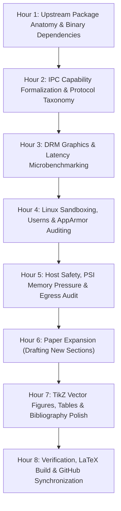

# Spec: 8-Hour Deep Systems Analysis & Paper Expansion Run

> - **Document:** `specs/DREAMFERENCE_MIGHTLING_DESKTOP_PAPER_RUN.md`
> - **Date:** 2026-10-21
> - **Execution Mode:** 8-Hour Autonomous / Long-Running Deep Analysis Run (Trigger via `/goal`)
> - **Target Repository:** [`https://github.com/dgxcoder/desktop-agent-paper`](https://github.com/dgxcoder/desktop-agent-paper) ([`~/desktop-agent-paper`](file://~/desktop-agent-paper))
> - **Target Publication:** Journal Submission (e.g., *IEEE Transactions on Software Engineering* / *ACM TOSEM*, expanded from 8 to 14--16 pages)
> - **Target Hardware:** NVIDIA GB10 (128 GB Unified LPDDR5X, Blackwell SM121, Ubuntu 24.04 LTS kernel 6.8.0-arm64)

---

## 1. Objectives & Scope

This specification defines the 8-hour autonomous research, systems measurement, and authoring workflow to transform the initial preprint into an authoritative, empirical journal publication on **desktop architectures for local, air-gapped AI coding agents**.

The run will systematically execute deep black-box systems analysis on both the commercial upstream package (`/usr/lib/chatgpt`) and the open Mightling desktop implementation, perform hardware-level graphics and memory benchmarks on the GB10, audit network egress and kernel sandboxing, and expand the paper with rigorous experimental data, formal theorems/state machines, and complete benchmark evaluations.

---

## 2. Research Workstreams & Experimental Protocols

### Workstream A: Upstream Package Anatomy & Binary Reverse-Engineering (Black-Box)
* **Objective**: Formulate a complete, empirical taxonomy of how commercial agent desktop applications are assembled, comparing the commercial package (`/usr/lib/chatgpt`) to open-source architectures.
* **Analysis Tasks**:
  1. **Dynamic Linker & Shared Object Audit**: Run `readelf -d` and `ldd` across `/usr/lib/chatgpt/ChatGPT` and its companion libraries (`libEGL.so`, `libGLESv2.so`, `libvulkan.so`, `libqt5_shim.so`, `libqt6_shim.so`). Categorize all native dependencies.
  2. **Bundled Native Node Modules**: Inspect `resources/cua_node` and plugins to identify all native C/C++ bindings (e.g., `classic-level`, `sharp`, `pixelmatch`, `better-sqlite3`, `node-pty`).
  3. **Launch Wrapper & Environment Protocol**: Analyze `codex-launcher` and runtime configuration flags (`owl-shell-runtime.json`, Electron version, Chromium base).
  4. **Output**: A comprehensive comparison table between standard Electron distributions, the upstream vendor's custom runtime, and Mightling's hardened build.

### Workstream B: Hardware Rendering & DRM Graphics Pipeline on GB10
* **Objective**: Empirically quantify the display subsystem failure modes of unified-memory desktop environments on NVIDIA Blackwell workstations.
* **Analysis Tasks**:
  1. **Direct Kernel Tracing**: Trace `DRM_IOCTL_MODE_CREATE_DUMB` calls via `strace` on WebKitGTK processes interacting with `/dev/dri/card1` and `/dev/dri/renderD128` to document exact return codes (`ENOSYS` vs `EACCES`).
  2. **High-Resolution Latency Microbenchmarks**: Execute automated 60-frame typing tests across 4 display geometries:
     * $1280 \times 860$ ($1.0\times$)
     * $1920 \times 1080$ ($1.0\times$)
     * $3840 \times 2160$ ($4\mathrm{K}$, $1.5\times$)
     * $5120 \times 2160$ ($5\mathrm{K}$ Ultrawide, $1.25\times$)
  3. **Performance Metrics**: Capture per-frame duration, CPU single-thread utilization, GPU memory bus throughput, and compositing latency (ANGLE GL/EGL vs WebKitGTK CPU rasterization).
  4. **Output**: Multi-curve latency distribution graphs and GPU pipeline architecture diagrams in TikZ.

### Workstream C: IPC Protocol Capabilities & Gating Formalization
* **Objective**: Replace ad-hoc IPC descriptions with a formal capability-based security model.
* **Analysis Tasks**:
  1. **Complete Protocol Taxonomy**: Map all 170 client request methods, 11 server requests, and 85 notifications from `codex/codex-rs/Cargo.toml` (`app-server-protocol`). Categorize each method by privilege tier:
     * Tier 0: Pure read-only state (e.g., `thread/read`, `config/read`).
     * Tier 1: Workspace mutation (e.g., `fs/writeFile`, `worktree/create`).
     * Tier 2: Process execution (e.g., `command/exec`, `terminal/create`).
     * Tier 3: Network / Remote synchronization (e.g., `account/login`, `telemetry/send`).
  2. **Policy Verification**: Formally evaluate [`ling-rs/web/policy.json`](file://~/mightling/ling-rs/web/policy.json) against the 170 methods, proving mathematically that Tier 3 methods are rejected with zero escape paths.
  3. **IPC Latency & Payload Benchmark**: Benchmark turnaround latency over stdio pipes vs Unix Domain Sockets vs TCP loopback for diff payloads ranging from 10\,KB to 16\,MB.
  4. **Output**: Formal capability matrix and state machine diagrams.

### Workstream D: Linux Host Safety & Sandboxing on Modern Kernels
* **Objective**: Evaluate how desktop developer tools coexist with strict Linux kernel security policies.
* **Analysis Tasks**:
  1. **User Namespace Analysis**: Demonstrate kernel failure modes under `kernel.apparmor_restrict_unprivileged_userns = 1` and verify that the custom AppArmor profile (`/etc/apparmor.d/mightling`) restores sandbox creation without granting root capabilities.
  2. **SUID Security Comparative Evaluation**: Contrast AppArmor user namespace profiles against legacy SUID root helpers (`chrome-sandbox`), citing CVE history of SUID sandbox escapes.
  3. **Electron Fuses Audit**: Run automated fuse verification scripts checking that `RunAsNode` and CLI inspect options cannot be re-enabled via environment variables.
  4. **Output**: Sandboxing threat model and security boundary table.

### Workstream E: Egress Confinement & Memory Pressure Coexistence
* **Objective**: Audit network isolation and workstation stability under extreme agent workloads.
* **Analysis Tasks**:
  1. **Network Egress Audit**: Run `ling-admin audit egress --app` with dynamic packet captures (`strace -f -e trace=network`), asserting 0 DNS queries and 0 non-loopback connections across live sessions.
  2. **Host Memory & PSI Coexistence**: Monitor Linux Pressure Stall Information (PSI `some`/`full` memory pressure) while serving a resident 27B NVFP4 model on SGLang simultaneously with an active, high-turn Electron desktop session.
  3. **Output**: Verified audit trace logs and memory residency timeline graphs.

---

## 3. 8-Hour Execution Timeline

| Timeline | Phase | Primary Deliverables |
| :--- | :--- | :--- |
| **00:00 -- 01:00** | Upstream Package Deep Dive | Dependency tree of `/usr/lib/chatgpt`, native module catalog, runtime configuration analysis. |
| **01:00 -- 02:00** | Protocol & Policy Audit | 170-method JSON-RPC taxonomy, capability verification of `policy.json`, IPC benchmark scripts. |
| **02:00 -- 03:00** | Graphics Benchmarks | Latency measurements on GB10, DRM dumb-buffer trace logs, ANGLE performance data. |
| **03:00 -- 04:00** | Sandboxing & Security Audit | User namespace kernel logs, AppArmor verification, Electron fuse inspection. |
| **04:00 -- 05:00** | Egress & Memory Coexistence | Strace network audit traces, memory coexistence and PSI monitoring logs. |
| **05:00 -- 06:30** | Paper Expansion (TeX Source) | Expanding `desktop-architecture.tex` to 14--16 pages; writing Sections on formal capability gating, DRM graphics pipeline, and empirical results. |
| **06:30 -- 07:30** | Figures, Tables & Bibliography | Adding vector TikZ diagrams (state machines, latency curves, multi-process topology), formatting data tables, expanding BibTeX references. |
| **07:30 -- 08:00** | Build, Verification & Sync | Compiling PDF via Docker TeX Live, fixing all layout warnings, committing and pushing to [`https://github.com/dgxcoder/desktop-agent-paper`](https://github.com/dgxcoder/desktop-agent-paper). |

---

## 4. Paper Expansion Structure (14--16 Pages Target)

The expanded manuscript will be organized as follows:
1. **§1 Introduction & Problem Formulation**: Air-gapped agentic pair-programming requirements; privacy and IP confidentiality; local workstation constraints.
2. **§2 Background & Threat Model**: Multi-process browser runtimes, language server protocols, untrusted code execution, zero-trust assumptions.
3. **§3 Empirical Packaging & Runtime Decomposition**: Black-box comparative analysis of commercial desktop packaging (`/usr/lib/chatgpt`) vs open standards.
4. **§4 Display Subsystem & Hardware-Level Rendering**: The DRM dumb-buffer failure mode on proprietary NVIDIA drivers; ANGLE translation; high-resolution frame latency study.
5. **§5 System Architecture & Multi-Process Confinement**: The three-tier model; privileged `app://` scheme; resident stdio agent daemon.
6. **§6 Formal Capability Gating & IPC Policy**: Formalization of `policy.json`; 170-method risk taxonomy; proof of non-bypassability.
7. **§7 OS-Level Sandboxing & Host Safety**: Linux unprivileged user namespaces; AppArmor profiles without SUID helpers; Electron fuse immutability.
8. **§8 Experimental Evaluation**:
   * Latency & frametime distributions across resolutions.
   * IPC throughput and turn-streaming overhead.
   * Host memory stability & PSI coexistence alongside resident 27B LLMs.
   * Egress audit validation under dynamic interactive workflows.
9. **§9 Related Work**: Agent frameworks, desktop security, container sandboxing.
10. **§10 Discussion & Threats to Validity**.
11. **§11 Conclusion & Artifact Availability**.

---

## 5. Automated Verification & Acceptance Criteria

At the conclusion of the 8-hour run, the following verifiable artifacts must be produced and validated:
- [ ] Complete empirical dataset: benchmark CSVs and logs stored in the repository.
- [ ] Expanded LaTeX source: `desktop-architecture.tex` expanded to $\ge 14$ pages with zero LaTeX compilation errors or citation gaps.
- [ ] Vector graphics: at least 3 TikZ architectural diagrams (process isolation, capability state machine, and latency CDF).
- [ ] Reproducible build: `make` passes cleanly inside `texlive/texlive` container producing `desktop-architecture.pdf`.
- [ ] GitHub Synchronization: All commits cleanly pushed to [`https://github.com/dgxcoder/desktop-agent-paper`](https://github.com/dgxcoder/desktop-agent-paper).
